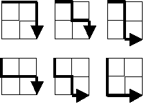

# Problem 15: Lattice Paths

> Source: <https://projecteuler.net/problem=15>

Starting in the top left corner of a $2 \times 2$ grid, and only being able to move to the right and down, there are exactly $6$ routes to the bottom right corner.

How many such routes are there through a $20 \times 20$ grid?

## Solution

[Problem015.kt](Problem015.kt) · [Problem015Test.kt](../../../../test/kotlin/euler/p015/Problem015Test.kt)

### Approach

Dynamic programming over the points of the grid: the number of routes to a point is the number of routes to the point above it plus the number to the point on its left.

**1. Points, not cells**

Routes run along the lines, so an $n \times n$ grid has $(n + 1) \times (n + 1)$ points, and the table has that size.

**2. First row and column**

A point on the top row or the left column can only be reached by going straight right or straight down, so each has exactly $1$ route.

**3. The rest of the table**

Every other point is entered either from above or from the left, so

$$\text{routes}[y][x] = \text{routes}[y][x - 1] + \text{routes}[y - 1][x]$$

Filling the table row by row, left to right, makes sure both values are ready when they are needed.
The answer is the bottom-right point, $\text{routes}[n][n]$.

**4. Connection to combinations**

Every route is a sequence of $n$ moves right and $n$ moves down, so the count is also $\binom{2n}{n}$, and the table is Pascal's triangle turned on its side.
The count fits in a `Long` up to $n = 33$. The addition uses `Math.addExact`, so from $n = 34$ it fails with an exception instead of returning a wrong number.

**Check with the example** ($n = 2$):

$$\begin{matrix} 1 & 1 & 1 \\ 1 & 2 & 3 \\ 1 & 3 & 6 \end{matrix}$$

The bottom-right point has $6$ routes.
